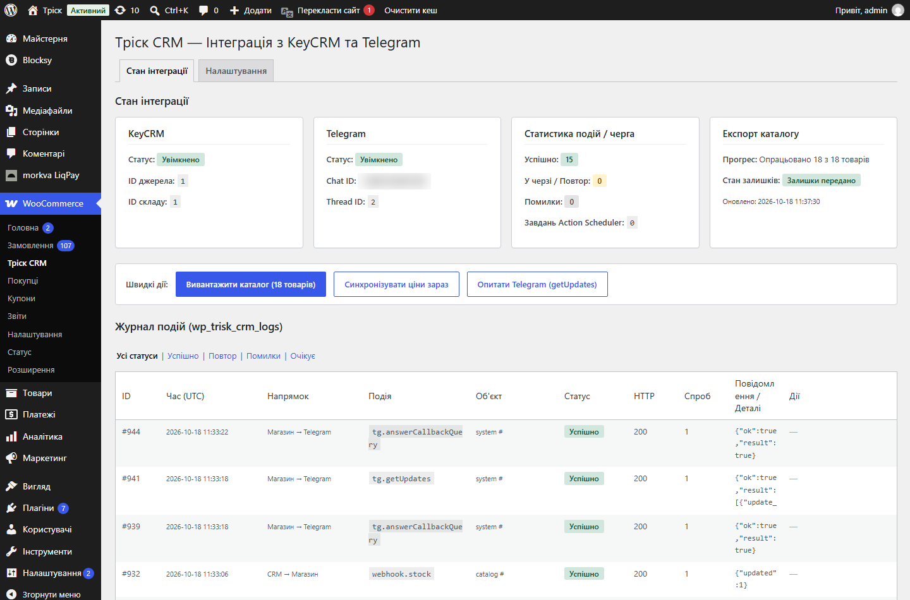
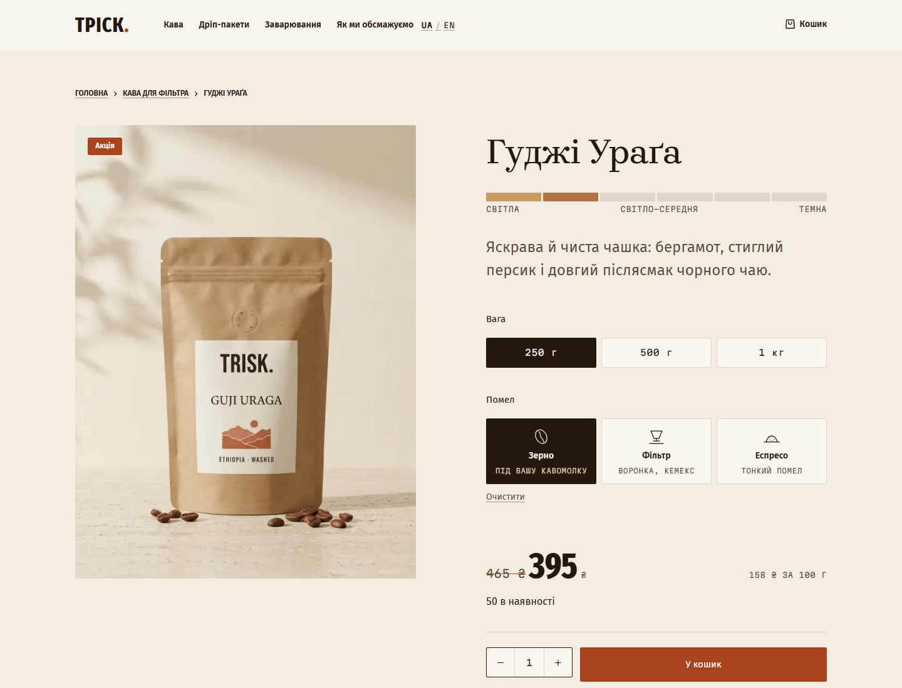
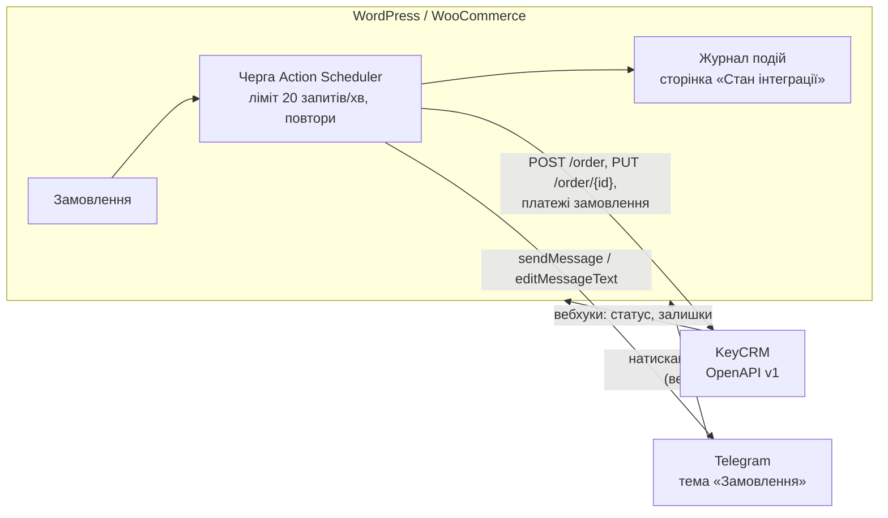

# WooCommerce ↔ KeyCRM ↔ Telegram

WordPress-плагін, який з'єднує магазин на WooCommerce з **KeyCRM** і **Telegram-групою менеджерів**.
Працює всередині WordPress, без сторонніх сервісів і окремого сервера.

Зроблений для демо-магазину кави **«Тріск»** (https://trisk-demo.duckdns.org) і перевірений наживо на пробному акаунті KeyCRM.
Бренд і товари вигадані, замовлення не виконуються.

## Що вміє

**Сайт → KeyCRM**
- Нове замовлення одразу створюється в KeyCRM: покупець, товари за SKU з характеристиками (вага, помел), доставка, оплата.
- Оплата LiqPay доходить у CRM: платіж замовлення стає «оплачено» — і коли замовлення створене вже оплаченим, і коли оплата прийшла пізніше.
- Зміна статусу в адмінці WooCommerce оновлює статус у KeyCRM.

**KeyCRM → сайт**
- Тригер KeyCRM «Зміна статусу замовлення» оновлює статус на сайті за таблицею відповідності статусів.
- Вебхук складу оновлює залишки: доступно = `in_stock − in_reserve`.
- Ціни підтягуються щогодини або кнопкою: якщо в CRM ціна нижча за базову, на сайті вона стає акційною з перекресленою старою.

**Telegram для менеджерів**
- Кожне замовлення — повідомлення в окремій темі групи: склад, сума, доставка, статус оплати.
- Кнопки «В роботі», «Відправлено», «Виконано», «Скасовано» змінюють статус на сайті й у KeyCRM та підписують, хто з менеджерів натиснув.
- Будь-яка зміна замовлення редагує те саме повідомлення, а не створює нове.
- Кнопки працюють лише в налаштованій групі; можна обмежити списком Telegram ID менеджерів.

## Як улаштовано

Надійність:
- **Черга замість синхронних запитів.** Чекаут не чекає на CRM. Запити йдуть через Action Scheduler з обмеженням KeyCRM 20 запитів/хв і повторами зі зростаючою паузою при 429 і 5xx.
- **Без дублів.** ID замовлення сайту передається як `source_uuid`. Якщо KeyCRM відповідає «вже існує» (422), плагін знаходить це замовлення й прив'язує його.
- **Без петель.** Зміна, що прийшла з CRM або з Telegram, не відправляється назад повторно.
- **Невідомі статуси не ламають замовлення.** Статус CRM, якого немає в таблиці відповідності, пропускається й пишеться в журнал.
- **Вебхуки захищені секретом.** Telegram — заголовком `X-Telegram-Bot-Api-Secret-Token`. KeyCRM не вміє надсилати заголовки, тому токен передається в адресі запиту.
- **Журнал кожного запиту** в обидва боки: код відповіді, спроби, помилки, кнопка «Надіслати повторно».

## Налаштування

1. Скопіювати `trisk-crm-sync/` у `wp-content/plugins/` і активувати. При активації варіаціям проставляються SKU, а замовлення, створені до активації, у CRM і Telegram не надсилаються.
2. **WooCommerce → Тріск CRM → Налаштування:** API-ключ KeyCRM, токен бота, ID джерела й складу.
3. «Підтягнути джерела й статуси з KeyCRM» → виставити відповідність статусів.
4. Додати бота в групу з темами → «Визначити ID групи й теми автоматично» → «Зареєструвати HTTPS-вебхук у Telegram».
5. У KeyCRM: **Налаштування → Додатково → Автоматизація → Додати тригер** «Зміна статусу замовлення» → дія «Відправити Webhook» (POST) з адресою зі сторінки налаштувань плагіна. Той самий URL — для вебхука складу.

Перевірено на WordPress 7.1, WooCommerce з HPOS і PHP 8.2. Для вебхуків потрібен HTTPS.

## Тести

`tests/test_crm_sync.py` — 23 сценарії pytest, які запускаються через WP-CLI проти Docker-копії демо-магазину (саме оточення в цей репозиторій не входить). Запити до KeyCRM і Telegram у тестах підміняються, справжні акаунти не потрібні.

Що перевіряється: формування замовлення для KeyCRM, обробка 422 і повторів, вебхуки статусу й складу, синхронізація цін, оплата рівно один раз, кнопки Telegram і захист від чужих чатів, відсутність петель, журнал.

## Обмеження

- Акційна ціна визначається порівнянням ціни з KeyCRM із базовою ціною на сайті, бо окремого поля знижки в KeyCRM немає. Деталі — у [trisk-crm-sync/README.md](trisk-crm-sync/README.md).
- Плагін писався під каталог «Тріску» (варіації «вага × помел», поля Нової Пошти в чекауті). Для іншого магазину треба адаптувати формування SKU й полів доставки.

---

## English

A WordPress plugin that connects a WooCommerce store with **KeyCRM** and a **Telegram group for managers**, running entirely inside WordPress.

- New orders are created in KeyCRM with the buyer, SKU-matched items, delivery and payment; LiqPay payments mark the CRM payment as paid.
- KeyCRM status triggers and stock webhooks update the store; prices are pulled hourly, and a lower CRM price becomes a sale price.
- Each order is a Telegram message with status buttons that update both the store and KeyCRM and sign the manager's name; the same message is edited on every change.
- Requests go through an Action Scheduler queue (KeyCRM limit of 20 requests/min, retries with backoff), duplicates are resolved via `source_uuid`, sync loops are prevented, and every request is logged.

Built for the fictional **Trisk** coffee store demo (https://trisk-demo.duckdns.org) and verified live on a KeyCRM trial account. 23 pytest scenarios with mocked KeyCRM and Telegram APIs.
